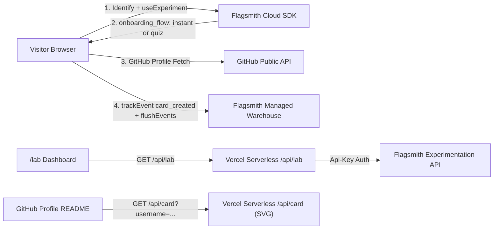

# DevCard — Holographic GitHub Developer Card

Built for the **WeMakeDevs × Flagsmith Hackathon** (*Test Something Real* track).

## Problem
Developers want a clean, shareable developer card for their GitHub profile README—but many developer tools lose visitors before the payoff by forcing multi-step customization up front.

## Hypothesis
A one-field instant onboarding (`"enter GitHub username, get your card"`) produces more created cards per visitor than a 3-step setup quiz (pick style, pick accent colour, then username), because less friction before the payoff wins.

## Flagsmith Setup (Experiment `#532`)
- **Project:** `devcard` (`56425`) · **Environment:** `Production`
- **Multivariate Flag:** `onboarding_flow` (ID `305002`)
  - `control` (default value): `"instant"` (50% traffic)
  - Keyed variation `quiz` (ID `36991`, `key: "quiz"`): `"quiz"` (50% traffic)
- **Metric:** `card_created` (ID `525`, `occurrence`, direction `up`)
- **Rollout:** 100% of visitors, 50/50 split
- **SDK Instrumentation (`@flagsmith/flagsmith` `12.6.0`):**
  - `src/lib/flagsmith.js`: generates/persists an anonymous `visitorId` in `localStorage` (`try/catch` with memory fallback), initializes `enableEvents: true` + `identity` before flag evaluation, tracks `card_created` + `await flagsmith.flushEvents()`, and flushes on `pagehide` / `beforeunload`.
  - `src/App.jsx`: wraps the app in `<FlagsmithProvider>` and evaluates `useExperiment('onboarding_flow')` where onboarding renders (recording `$flag_exposure`).
  - `api/github.js` + `api/_github.js`: server-side GitHub proxy with `GITHUB_TOKEN`, ETag conditional requests, 1-hour in-memory cache, and `Cache-Control: public, s-maxage=3600, stale-while-revalidate=86400`.
  - `api/card.js`: uses the same cached `api/_github.js` helper to return an embeddable `image/svg+xml` card for GitHub READMEs. Never fires conversion events.
  - `api/lab.js`: reads Experiment `532` + `/results/` server-side using `FLAGSMITH_API_KEY`.

## Architecture



## Local Setup

1. **Install dependencies:**
   ```bash
   npm install
   ```
2. **Configure environment variables:**
   Copy `.env.example` to `.env` and set your keys (never commit `.env`):
   - `VITE_FLAGSMITH_ENV_KEY` — Client-side Flagsmith environment key
   - `FLAGSMITH_API_KEY` — Server-side Flagsmith API key (for `/api/lab`)
   - `GITHUB_TOKEN` — *(optional)* GitHub PAT to raise `/api/card` rate limits
3. **Run locally:**
   ```bash
   npm run dev
   ```
   A lightweight Vite `configureServer` middleware in `vite.config.js` loads `.env` and routes `/api/github`, `/api/lab`, and `/api/card` directly to `api/` during `npm run dev` on `http://localhost:5173`. Alternatively, you can run the full Vercel serverless runtime locally with:
   ```bash
   npx vercel dev
   ```

## Results & What We Learned
*Pending: experiment collecting data (Experiment `532` will be started once deployed to Vercel).*

## Credits
- Built with Vite, React, `@flagsmith/flagsmith`, and `lottie-web` (lazy-loaded optional animation slots in `public/animations/`).
- Fonts: `Inter` and `JetBrains Mono` via Google Fonts.
